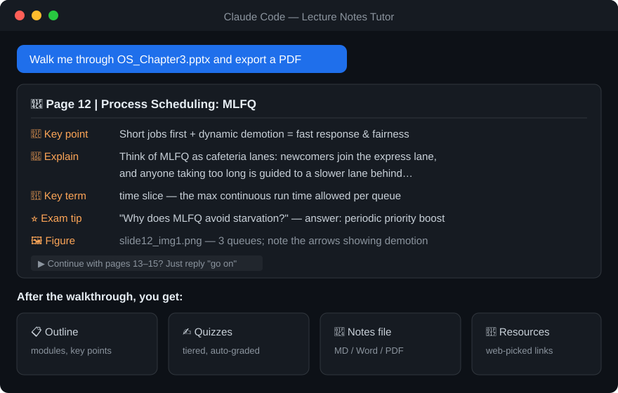
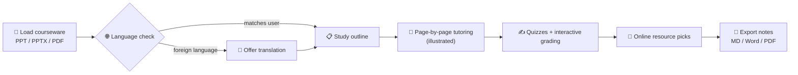

<p align="center">
  
</p>

<h1 align="center">Lecture Notes Tutor</h1>

<p align="center">
  A Claude Code skill — an AI tutor that walks you through your courseware (PPT / PDF), page by page
</p>

<p align="center">
  
  
  
</p>

---

## ✨ What it does

Drop your courseware into Claude Code, and it tutors you like a patient TA:

| Feature | Description |
|---|---|
| 📖 **Page-by-page explanation** | Breaks down every slide/page: key point, plain-language explanation (Feynman style), key terms, exam tips, and links to surrounding pages |
| 🗂 **Study outline first** | Reads the whole deck, then proposes modules with ⭐ key points and ⚠️ difficult points — you decide what to dive into |
| ✍️ **Practice quizzes** | Three tiers (basic / applied / challenge) with answers & explanations in a separate section; interactive grading mode available |
| 🔗 **Online resources** | Searches the web for open courses (MIT OCW, Coursera, …), explainer videos, and classic textbooks — each mapped to the relevant section |
| 🌐 **Foreign-language courseware** | If you chat in Chinese but the slides are in English, it asks: translate & explain, bilingual side-by-side, or keep the original |
| 🖼 **Illustrated explanations** | Extracts the original figures per slide; draws SVG diagrams for key concepts; every figure comes with a caption |
| 📄 **Notes export** | Compiles the whole walkthrough into a **Markdown / Word / PDF** document with embedded figures |
| 🧪 **And more** | Mock exams, Anki-style flashcards, spaced-repetition study plans, Socratic weak-point diagnosis |

## 📸 Preview

<p align="center">
  
</p>

## 🔧 Workflow



## 🚀 Installation

Clone the repo into your Claude Code skills directory (folder name must be `lecture-notes-tutor`):

**Windows**

```bash
git clone https://github.com/YUANYINGLONG-91/lecture-notes-tutor.git "%USERPROFILE%\.claude\skills\lecture-notes-tutor"
```

**macOS / Linux**

```bash
git clone https://github.com/YUANYINGLONG-91/lecture-notes-tutor.git ~/.claude/skills/lecture-notes-tutor
```

Or clone into a project's `.claude/skills/` to enable it for that project only.

## 💡 Usage

Just talk to Claude Code after installing, e.g.:

- "Explain this deck to me: `OS_Chapter3.pptx`"
- "Go deep on pages 20–35 of `linear-algebra.pdf`"
- English slides but you chat in Chinese → it proactively offers translation
- "Quiz me afterwards" / "Export it as a PDF" / "Find me some related online courses"

## ⚙️ Requirements

| Scenario | Dependency |
|---|---|
| Reading PDFs, extracting PPTX text & images | **Python 3 stdlib only** — zero install |
| PPT→PDF conversion, Word/PDF export | Windows + Microsoft Office + `pywin32` (`pip install pywin32`); without Office it falls back to a styled HTML you can print to PDF from any browser |

## 🗂 Repository layout

```
├── SKILL.md                      # Skill entry: triggers + workflow
├── references/
│   └── output-formats.md         # Templates: outline, per-page card, quizzes, exported doc
├── scripts/
│   ├── extract_pptx.py           # Per-slide text & speaker notes from PPTX (stdlib only)
│   ├── extract_images.py         # Per-slide image extraction from PPTX (stdlib only)
│   ├── ppt_to_pdf.py             # PPT/PPTX → PDF via local PowerPoint
│   └── export_doc.py             # Notes Markdown → styled HTML → Word / PDF
└── assets/                       # README artwork
```

## 📄 License

[MIT](LICENSE)
